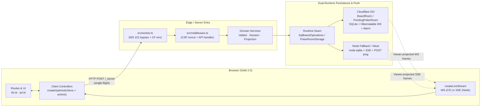

# Retrocks — Technical Onboarding Guide

> **Interactive visual version:** Open [`docs/onboarding.html`](./onboarding.html) directly in any browser for the interactive architecture explorer, clickable layer inspector, flow stepper, and filterable module map.

Retrocks is a **zero-login, privacy-first** collaborative web app with two live workspaces:

1. **Retrospective Boards** (`/retro` → `/b/:id`) — anonymous Cards, Columns, Card Groups, Votes (with Blind Voting), Private Mode, Countdown Timer, Action Items, Reactions/Comments, and Print/Export.
2. **Pointing Poker Rooms** (`/pointing-poker` → `/p/:id`) — live story estimation with session-local Display Names, Story Queue, configurable Decks, Voting Rounds, Locked Stories, and Close/Reopen lifecycle.

---

## 1. Day-1 Quickstart

```bash
pnpm install
cp .env.example .env
# Generate a 32+ char SESSION_SECRET and put it in .env:
openssl rand -base64 32
```

| Command | Purpose |
| --- | --- |
| `pnpm dev` | Default local dev on **Cloudflare Workers (`workerd`) + SQLite Durable Objects** (`http://127.0.0.1:3002`) |
| `pnpm dev:node` | Standalone **Node.js + `node:sqlite` + SSE** fallback (`RETROCKS_RUNTIME=node`) |
| `pnpm test` | Runs both Vitest projects: `client` (`jsdom`, `src/**/*.test.tsx`) and `server` (`node`, `src/server/**/*.test.ts`) |
| `pnpm typecheck` | TypeScript 7 check (`tsc --noEmit`) |
| `pnpm lint` | Fast lint via `oxlint src` |
| `pnpm knip` | Unused files, exports, and dependencies check |
| `pnpm build` / `pnpm deploy` | Cloudflare production build and `wrangler deploy` |
| `pnpm build:node && pnpm start` | Standalone Node production build (`dist/server/node.js`) |

---

## 2. High-Level Architecture

Retrocks is built around two core design decisions documented in [ADR-0001](./adr/0001-anonymous-capability-tokens.md) and [ADR-0002](./adr/0002-dual-runtime-adapters-and-http-mutations.md):

- **HTTP-Write / Push-Read Split:** All mutations travel over HTTP via Solid `'use server'` functions (`dispatchBoardCommand`, `changePokerRoom`, or `formAction`). WebSockets (Cloudflare) and SSE (Node) are strictly server-to-client push + presence channels.
- **Dual-Runtime Adapter Seam:** Narrow interfaces (`BoardStore`, `BoardRealtime`, `getPokerRoomAccess`) separate domain logic from storage/push infrastructure so the exact same SQLite queries run on Cloudflare Durable Objects and Node `node:sqlite`.



---

## 3. Security, Privacy & Auth Model (ADR-0001)

- **Zero accounts / zero PII:** Signed `HttpOnly` cookie (`retrocks_session`, HMAC-SHA256 via `@remix-run/cookie`, 90-day sliding TTL) holds only `{ p: participantId, f: facilitatorBoards[<=35], exp }`.
- **Key rotation:** `SESSION_SECRET` accepts comma-separated secrets (newest first) — first signs/encrypts, all verify/decrypt.
- **Per-Board identity isolation:** `participantId` is salted-hashed (`SHA-256`) with each Board's `token_salt`, making participants unlinkable across Boards.
- **Co-Facilitator Links (`#f=<token>`):** 256-bit base64url tokens are stored salted-hashed (verification) and AES-256-GCM encrypted at rest (bound with AAD). They travel in the URL **fragment** (never `?f=`), are exchanged into the `HttpOnly` cookie, and immediately scrubbed via `history.replaceState`.
- **Zero-peeking server projection:** `src/server/domain/projection.ts` and `projectPokerRoom` build DTOs from an explicit allowlist. Private Mode redaction (even for Facilitators) and Blind Voting aggregate hiding are enforced on the server for both HTTP responses and live frames.
- **Hardened HTTP headers:** `src/server/security-headers.ts` sets per-request CSP script nonces, `X-Frame-Options: DENY`, `Referrer-Policy: no-referrer`, `X-Robots-Tag: noindex, nofollow` on `/b/*` and `/p/*`, `Cache-Control: no-store` on Poker routes, and `event.renderMode = 'async'` on workspace `GET` requests so initial cookie minting and 404s resolve before response headers flush.

---

## 4. Codebase Map (Where to Start Reading)

| Area | Key Files | What They Own |
| --- | --- | --- |
| **Entry & Config** | `vite.config.ts`, `wrangler.jsonc`, `env.ts`, `src/worker.ts`, `src/middleware.ts`, `src/router.ts`, `src/server-config.ts` | Dual-runtime build, typed Standard Schema env, WS 101 bypass, CSP, filesystem routing, single-flight collector |
| **Retro Boards (Client)** | `src/routes/b/[id].tsx`, `src/lib/board-controller.ts`, `src/lib/board-actions.ts`, `src/lib/board-store.ts`, `src/components/BoardWorkspaceContext.tsx` | Board route preload, optimistic store & command dispatch, live delta reconciliation, reactive workspace context |
| **Retro Boards (Server)** | `src/server/services/board-service.ts`, `src/server/db/schema.ts`, `src/server/db/sql-board-operations.ts`, `src/server/domain/projection.ts` | Validation, rate limits, 7-table SQLite schema, atomic mutations, allowlist DTO redaction |
| **Pointing Poker (Client)** | `src/routes/p/[id].tsx`, `src/lib/poker-controller.ts`, `src/lib/poker-actions.ts`, `src/lib/poker-discard-policy.ts`, `src/lib/poker-deck-policy.ts` | Room phase state machine (live/closed/reopening), optimistic voting, discard confirmations |
| **Pointing Poker (Server)** | `src/server/poker/service.ts`, `src/server/poker/room.ts`, `src/server/poker/runtime.ts`, `src/server/poker/durable-room.ts`, `src/server/poker/node.ts` | Room storage engine, dual-runtime access seam, DO WebSocket & Node SSE implementations |
| **Shared Client Infra** | `src/lib/live-stream.ts`, `src/lib/inline-edit.ts`, `src/lib/wire-schemas.ts` | WS/SSE live transport (30s heartbeat / 65s watchdog / backoff), unified `@ui-sdk/core` inline editor, runtime payload validation |
| **Server Adapters & Auth** | `src/server/adapters/runtime.ts`, `src/server/adapters/cloudflare/board-room.ts`, `src/server/adapters/node/sqlite-board-store.ts`, `src/server/session.ts`, `src/server/facilitator-capability.ts` | Runtime resolution, Cloudflare DO & Node SQLite/SSE implementations, signed cookies & encrypted facilitator tokens |

---

## 5. Solid 2.0 & Repo Conventions

Full rules live in [`AGENTS.md`](../AGENTS.md) and [`GLOSSARY.md`](../GLOSSARY.md). The top gotchas for newly onboarded engineers:

1. **Solid 2.0, not React or Solid 1.x:**
   - Never destructure component `props`; pass values (`<C value={count()} />`), not accessors.
   - Mutate `createStore` via drafts: `setStore(s => { s.x = 1; })`.
   - Use `<Loading>`, `<Errored>`, `onSettled`, `createStore` from `solid-js`, and `render` from `@solidjs/web`.
   - Reads lag writes until the microtask — call `flush()` in tests before asserting.
2. **Avoid `createEffect` by default:** Prefer `createMemo`, declarative JSX bindings, `ref` callbacks, event handlers, and `onSettled`. When strictly needed, always use the two-argument form `createEffect(compute, apply)`. Current live-sync effects are audited in [`docs/live-synchronization-effects.md`](./live-synchronization-effects.md).
3. **Strict server boundary & env safety:** Mark server modules with `import 'server-only'`. Read validated env via `virtual:solid-env/server` or `virtual:solid-env/client` (declared in `env.ts`). Never touch or commit `.env`.
4. **Styling & UI primitives:** Use Tailwind CSS v4 utilities first (reuse via utility classes in CSS rather than ad-hoc vanilla CSS) and build interactive controls with `@ui-sdk/solid` / `@ui-sdk/core`.
5. **Ubiquitous language:** Follow [`GLOSSARY.md`](../GLOSSARY.md) — e.g., **Participant** & **Facilitator** (not user/admin), **Board** (Retro) vs. **Room** (Poker), **Private Mode**, **Blind Voting**, **Card Group**, **Co-Facilitator Link**, **Locked Story**, **Accepted Estimate**.

---

## 6. Reference Docs & ADRs

- [`GLOSSARY.md`](../GLOSSARY.md) — Canonical domain terms
- [`AGENTS.md`](../AGENTS.md) — Solid 2.0 primer & repo conventions
- [`docs/adr/`](./adr/) — Architecture Decision Records (`0001`–`0004`)
- [`docs/cloudflare-workers-deployment.md`](./cloudflare-workers-deployment.md) — Deployment details
- [`docs/live-synchronization-effects.md`](./live-synchronization-effects.md) — Live-sync effect audit
- [`docs/SPEC.md`](./SPEC.md) & [`docs/pointing-poker-spec.md`](./pointing-poker-spec.md) — Full product specs
