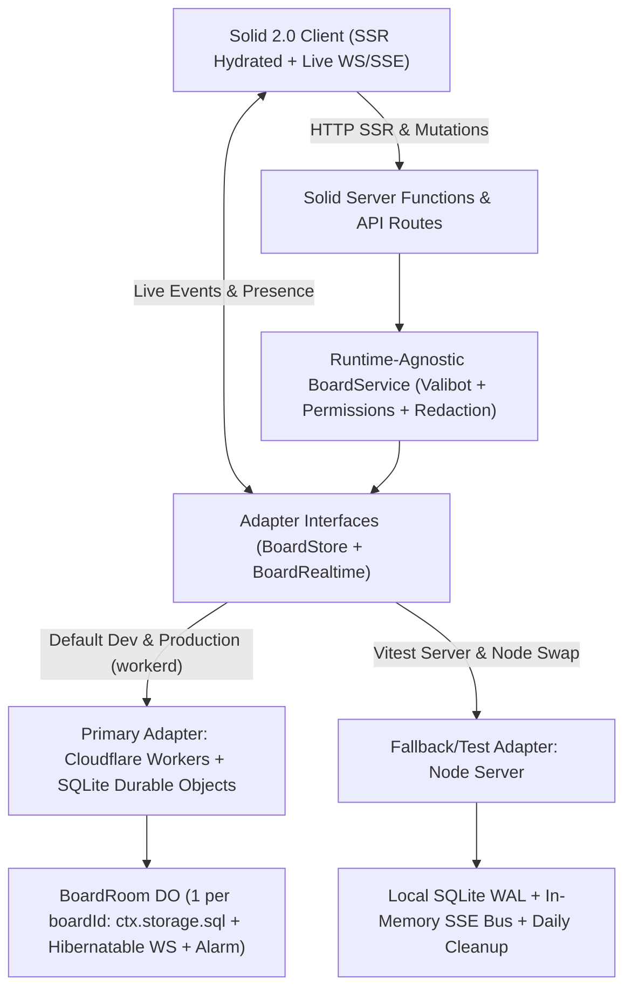

# Retrocks — Product & Technical Specification

> **Status:** Final v1.0 — Approved  
> **Stack:** Solid 2.0 Full-Stack (`solid-js` 2.0, `@solidjs/web`, `@solidjs/router`, `@solidjs/vite-plugin` v3, Tailwind CSS v4, Valibot)  
> **Primary Runtime:** Cloudflare Workers + SQLite Durable Objects (default `pnpm dev` & production via `@cloudflare/vite-plugin`), isolated behind runtime-agnostic adapters for Node + SQLite + SSE (Vitest & self-hosted swap)  
> **Domain Docs:** [GLOSSARY.md](../GLOSSARY.md) · [ADR-0001](./adr/0001-anonymous-capability-tokens.md) · [ADR-0002](./adr/0002-dual-runtime-adapters-and-http-mutations.md)

---

## 1. Product Vision & Principles

**Retrocks** is a free, instant, privacy-first web application for agile sprint retrospectives, team reflections, and collaborative brainstorming. It takes the zero-friction simplicity of **IdeaBoardz** and pairs it with modern facilitation workflows in a crisp, minimal, mobile-friendly interface.

### Non-Negotiable Principles

1. **Zero Login, Zero Personal Information:** Never ask for an email, display name, account creation, or personal profile. No tracking cookies, no third-party analytics, no ads, no paywalls — free in all senses.
2. **Link-First Frictionless Flow:** Create a Board in under 5 seconds, copy the URL, and start collaborating immediately.
3. **Minimal, Modern Aesthetic:** Inspired by Linear and Notion — clean neutral canvas, generous whitespace, subtle pastel column accents, crisp typography, and native light + dark modes.
4. **Mobile-First & Keyboard-Friendly:** Effortless on phones (tabbed single-column view, touch-friendly menus, bottom quick-add) and fast for desktop power users (keyboard shortcuts, drag-and-drop).
5. **Live & Async Ready:** Supports both real-time facilitated retro meetings (live sync, timer, Private Mode / Reveal All) and asynchronous multi-day IdeaBoardz-style collection.
6. **Runtime-Agnostic Core:** Domain logic, validation, and Solid 2.0 UI never couple directly to Cloudflare APIs. Persistence and real-time fan-out live behind clean interfaces so switching between Cloudflare Workers + Durable Objects and Node + SQLite + SSE is an adapter-level swap.

---

## 2. Anonymous Identity & Permission Model

Because Retrocks collects no user accounts or personal data, ownership and facilitation rely entirely on **opaque, cryptographic anonymous tokens** (see [ADR-0001](./adr/0001-anonymous-capability-tokens.md)).

### 2.1 Anonymous Participant Identity (`participantId`)
- Minted lazily on the first `GET /b/:id` visit (or Board creation `POST`) if absent — never on `/` unless creating a Board. Minting on initial Board `GET` guarantees the subsequent WebSocket/SSE handshake immediately carries `participantHash` (preventing Private Mode redaction races on a Participant's first Card).
- Stored in a signed, `HttpOnly`, `SameSite=Lax` cookie (`@remix-run/cookie`, HMAC-SHA256 via WebCrypto) with `Secure` enabled whenever served over HTTPS (conditional for local HTTP development) and a **90-day `Max-Age` with sliding renewal** on writes / near-expiry.
- The raw token is **never exposed to other Participants** and is persisted in the database only as a per-Board salted SHA-256 hash (`author_token_hash`, `voter_token_hash`, `reactor_token_hash`).
- Enables:
  - Editing and deleting **your own** Cards and comments.
  - Viewing and managing **your own** unredacted Cards while **Private Mode** is active.
  - Enforcing configurable per-Participant Vote caps and toggling your own Votes and reactions.

### 2.2 Anonymous Facilitator Capability (`facilitatorToken`)
- When a Board is created, the server generates a high-entropy 256-bit `facilitatorToken` and stores:
  - Its SHA-256 hash (`facilitator_token_hash`) for verification, and
  - An **AES-256-GCM encrypted copy** (`facilitator_token_encrypted`) keyed from `SESSION_SECRET` (supporting secret rotation) so any verified Facilitator can retrieve the Co-Facilitator Link on demand without storing raw tokens in `localStorage`.
- The creator automatically receives a signed `HttpOnly` Facilitator grant for that `boardId` inside the session cookie (bounded to the most recent ~30–40 facilitated Board IDs to stay well within the 4KB cookie ceiling).
- **Co-Facilitator Link:** Any Facilitator can copy `/b/<boardId>#f=<facilitatorToken>` from the Share Modal — or **rotate** the token if leaked (generating a fresh token and invalidating previously shared links).
  - Because `#f=...` is a client-side URL fragment, it is **never sent in HTTP requests, server logs, or `Referer` headers**.
  - On load, the client reads the fragment, exchanges it via a server function (`claimFacilitatorRole`) to set the signed `HttpOnly` Facilitator grant, and immediately scrubs the fragment via `history.replaceState`.

### 2.3 Permission Matrix

| Action | Participant (Unlocked) | Facilitator (Unlocked) | Participant (Locked) | Facilitator (Locked) |
| :--- | :---: | :---: | :---: | :---: |
| View Board, search, sort, filter, export | Yes | Yes | Yes | Yes |
| Create Cards | Yes | Yes | No | No |
| Edit / delete / move **own** Cards | Yes | Yes | No | No |
| Edit / delete / move **any** Card | No | Yes *(revealed only)* | No | No |
| Create comments & reactions | Yes *(revealed only)* | Yes *(revealed only)* | No | No |
| Delete **own** comments | Yes | Yes | No | No |
| Delete **any** comment | No | Yes *(revealed only)* | No | No |
| Vote / unvote (within Board Vote limit) | Yes *(revealed only)* | Yes *(revealed only)* | No | No |
| Group / merge & ungroup Cards | No *(default; configurable)* | Yes *(revealed only)* | No | No |
| Flag / unflag Action Items | Yes *(revealed only)* | Yes *(revealed only)* | No | No |
| Toggle `actionDone` & edit `actionOwner` on existing Action Items | Yes *(revealed only)* | Yes *(revealed only)* | No | Yes |
| Rename Board; add / edit / reorder / delete Columns | No | Yes | No | No |
| Toggle Private Mode & Reveal All | No | Yes | No | No |
| Control shared countdown timer | No | Yes | No | No |
| Configure Vote limits / Blind Voting / Reset all Votes | No | Yes | No | No |
| Lock / Unlock Board | No | Yes | No | Yes |
| Copy or rotate Co-Facilitator Link / Delete Board permanently | No | Yes | No | Yes |

> [!NOTE]
> **Optional Egalitarian Grouping Toggle:** Facilitators can optionally enable *"Allow any Participant to group & organize Cards"* in Board Settings (`allow_participant_group`, default `false`) for smaller, high-trust teams that prefer open collaboration while keeping Facilitator controls for timer, Private Mode, and Lock.

---

## 3. Feature Specification

### 3.1 Home & Instant Board Creation (`/`)
- **Zero-clutter hero & creator:** Immediate Board creation form right above the fold — no marketing walls or signup banners.
- **Board Metadata:**
  - Board Title (optional; defaults to `"Sprint Retrospective — <MMM D>"`, max 120 chars).
  - Optional short context/subtitle (max 240 chars, e.g., `"Sprint 42 · Checkout Team"`).
- **Curated Templates** (visual mini-column previews, fully editable before creation):
  1. **Standard Retro** — Went Well / To Improve / Action Items *(marked `isActionColumn`)*
  2. **Start / Stop / Continue** — Start Doing / Stop Doing / Continue Doing
  3. **Mad / Sad / Glad** — Mad / Sad / Glad
  4. **4Ls** — Liked / Learned / Lacked / Longed For
  5. **Starfish** — Keep Doing / Less Of / More Of / Stop Doing / Start Doing
  6. **Sailboat** — Wind (Helps Us) / Anchor (Holds Us Back) / Rocks (Risks) / Island (Goals)
  7. **Six Thinking Hats** — Facts (White) / Feelings (Red) / Caution (Black) / Benefits (Yellow) / Creativity (Green) / Process (Blue)
  8. **Pros & Cons** — Pros / Cons
  9. **Custom Board** — 1 to 10 customizable Columns (add, remove, rename, drag-reorder, choose subtle pastel accent).
- **Collapsible Advanced Options** (sensible defaults, hidden until expanded):
  - Votes per Participant: `3` / `5` *(default)* / `10` / `Unlimited`
  - Max Votes per Card / Card Group: `Unlimited (stackable)` *(default)* / `1 per Card or Card Group`
  - Start in Private Mode: `Off` *(default)* / `On`
  - Auto-expiry on inactivity: `30 days` / `90 days` *(default)* / `180 days`
- **Recent Boards (Client-Side Only):**
  - Stored strictly in `localStorage` (never transmitted to or stored on the server; stores only Board ID, title, last visited timestamp, and a non-sensitive boolean display hint — never raw tokens).
  - Displays recently created/visited Boards with title, last visited relative time, and a one-click remove-from-history action.

---

### 3.2 Board Workspace & Core Card Operations (`/b/:boardId`)
- **Board header:**
  - Lead with the Board title and optional context. The Retrocks link returns home, and Facilitators can rename an unlocked Board from the title.
  - Keep online presence, Countdown Timer, and active Board states near the title. Show reconnecting when live updates are interrupted. Private Mode explains who can read a Card before Reveal All.
  - Keep Share and More in the header. More holds theme, export, and Board Settings for Facilitators. Show Action Items and its open count once. Place it in the header with at least 26 rem of available header width (416 CSS px at the default text size) and in More at narrower widths. Keep the Board title and status labels on separate, wrapping rows on phones.
- **Columns (1–10):**
  - Use a small accent marker, a wrapping title, and a tabular Card count. Use opaque Cards on the open Column rail.
  - Offer **+ Add Card** at the top of each desktop Column and one bottom composer on phones. The phone composer names its target Column and keeps a draft for each Column. Enter submits, Shift+Enter starts a new line, and a failed submission keeps the draft and displays its error by the composer.
  - Facilitators of unlocked Boards can add Columns at the end of the desktop rail or from More on phones. Rename, reorder, accent, and delete controls stay with each Column. Deletion requires confirmation.
- **Cards:**
  - Plain text up to 1,000 characters; safely rendered with preserved line breaks, clickable auto-linked `https?://` URLs, and inline backtick code spans (zero raw HTML).
  - Subtle relative timestamp (e.g., `2m ago`) — strictly no author name or avatar.
  - Subtle `"You"` micro-indicator (visible **only** to the Card's own author) so Participants recognize their own Cards.
  - Give each Card an opaque surface, body text starting at 1 rem, and wrapping metadata for ownership, timestamps, Votes, reactions, and comment counts.
  - **Card actions** exposes the commands available to the current Participant, including **Edit Card**, **Move to…**, **Group with…**, and **Delete Card**. Keyboard users can navigate the menu with arrow keys and return to its trigger with Escape. Editing stays inline and a failed save keeps its draft and shows the error beside it. Deletion requires inline confirmation.
  - Drag Cards across Columns to move them or onto another Card or Card Group to group them. Manual ordering within a Column is unavailable.

---

### 3.3 Configurable Voting & Blind Voting
- **Voting Mechanics:**
  - When a Vote limit is configured (e.g., 5 Votes/Participant), a clean remaining-votes pill appears in the toolbar (`3 / 5 votes left`).
  - Clicking `+` on a standalone Card or Card Group casts a Vote (`+1`); clicking `-` (or secondary remove action) removes one of your Votes (`-1`).
  - Supports either **stackable voting** (multiple Votes on one high-priority Card/Card Group, default) or **1-Vote-per-Card-or-Card-Group** mode, plus **Unlimited** mode (classic IdeaBoardz style).
  - Voting on other Participants' redacted Cards while Private Mode is ON is rejected server-side.
- **Blind Voting Option:**
  - Facilitator can toggle **Blind Voting** ON/OFF so Participants aren't anchored by early leaders.
  - While Blind Voting is active, Participants see their own cast Vote count per Card/Card Group, while aggregate totals remain redacted (`null`) server-side until Blind Voting is turned off.
- **Facilitator Controls:** Adjust Vote budget at any time or **Reset All Votes** (with confirmation).

---

### 3.4 Private Mode (Anti-Groupthink Writing)
- Facilitator toggles **Private Mode** ON/OFF from the header bar.
- **Zero-Peeking Server-Side Redaction (Including Facilitators):**
  - When `isBlurred = true`, the server **never transmits other Participants' Card plaintext** over HTTP or WebSockets/SSE — not even to a Facilitator.
  - Other Participants' Cards are sent with `redacted: true` and an approximate `placeholderLines` hint (`1 | 2 | 3`) so the UI renders clean, realistic frosted/blurred skeleton Cards without leaking text to DevTools.
  - While Private Mode is ON, every Participant (including Facilitators) can freely create, view, edit, move, and delete their **own** Cards, while actions against other Participants' redacted Cards (editing, deleting, grouping, voting, reactions, comments, flagging) are **rejected server-side** until Reveal All.
- **Simultaneous Reveal:**
  - Clicking **Reveal All** flips `isBlurred = false` atomically and broadcasts a fresh per-viewer snapshot to every connected client simultaneously with a smooth unblur transition.

---

### 3.5 Shared Countdown Timer
- **Server-Authoritative Sync:**
  - Stores `timerEndsAt` (UTC epoch ms when running), `timerRemainingMs` (when paused), and `timerDurationMs` (total duration for progress bar).
  - Clients compute clock offset from `serverNow` on sync and render smoothly using `tabular-nums`.
- **Facilitator Controls:**
  - Quick presets: `3m`, `5m`, `10m`, `15m`, or custom minutes (1–60m).
  - Start, Pause, Resume, `+1 min`, Reset / Dismiss.
- **Participant Experience:**
  - Clean timer pill in the header with subtle visual progress ring/bar.
  - Gentle Web Audio chime when reaching `00:00` (with an individual per-user mute toggle stored in `localStorage`) plus a calm visual pulse.

---

### 3.6 Card Grouping & Merging
- Combine duplicate or related Cards into a **Card Group** inside a Column (disabled for redacted Cards while Private Mode is ON):
  - **Desktop:** Drag and drop one Card onto another Card (or onto an existing Card Group).
  - **Mobile & Keyboard:** Open **Card actions**, choose **Group with…**, and select a target Card or Card Group in the Column.
- **Card Group Behavior & Voting Rules:**
  - Displays an editable **Card Group Title** (e.g., `"CI Flakiness"`), Card count badge, **combined Vote total** (sum of pre-merge member Card Votes + Votes placed directly on the Card Group), and an expand/collapse toggle.
  - **Group-Level Voting Only:** Once Cards belong to a Card Group, live voting happens **exclusively on the Card Group header** (one unified `+`/`-` control); individual member Cards do not show separate interactive vote buttons while grouped.
  - **Grandfathering on Merge:** If `max_votes_per_card` is set (e.g., `1`) and merging combines Cards a Participant already voted on, their existing Votes are **preserved (grandfathered)** rather than silently stripped. New `+1` clicks on that Card Group are blocked while their combined Vote count on the group is `>= max_votes_per_card`. Clicking `-1` removes their direct group Vote first, then any pre-merge member-Card Vote they cast.
  - **Auto-Dissolve & Vote Refunds:** Individual member Cards can be **Ungrouped**, or the entire Card Group can be **Dissolved**. If ungrouping or deleting a Card leaves **fewer than 2 Cards** in a Card Group, it **automatically dissolves** back into a standalone Card. When a Card Group dissolves, any Votes placed directly on the group are deleted (automatically **refunding** those Votes to each voter's remaining budget), while pre-merge Card-level Votes remain attached to their respective Cards.
  - Dragging a Card Group to another Column moves all member Cards with it.

---

### 3.7 Anonymous Emoji Reactions & Lightweight Comments
- **Emoji Reactions:**
  - Curated, minimal 6-emoji set: `👍`, `❤️`, `🎉`, `🤔`, `🔥`, `👀`.
  - Toggle on/off per Participant per Card (disabled on redacted Cards during Private Mode). Displayed as compact count pills below the Card body; picker opens cleanly on tap/click.
- **Card Comments:**
  - Lightweight anonymous discussion notes on any revealed Card (max 500 chars, up to 50 comments per Card).
  - Cards show only a minimal comment count pill (e.g., `2`) when comments exist so the Board stays uncluttered.
  - The Card details button and comment count open a right-side drawer at 640 CSS px and wider and a bottom sheet on narrower screens. Both show the Card, reactions, Action Item controls, and comments.
  - The modal has a scrim, explicit close, Escape dismissal, contained keyboard focus, and focus return to the opening control or Board when that control disappears. Dismissal can interrupt entry. Reduced motion removes sliding. A viewer snapshot that redacts the Card removes its content and closes the modal immediately.
  - Posting shows pending feedback. A failed comment stays in the composer with its error and can be submitted again.
  - Authors can delete their own comments; Facilitator can delete any revealed comment (both with compact inline confirmation).

---

### 3.8 Dedicated Action Items View & Tracking
- Any revealed Card can be flagged as an **Action Item** from its menu or detail drawer. Cards created inside a Column marked `isActionColumn` (e.g., the "Action Items" Column in Standard Retro) are automatically flagged as Action Items.
- **Action Item Fields (Zero PII):**
  - `actionDone`: boolean checkbox (`Open` / `Done`).
  - `actionOwner`: optional short free-text tag (max 40 chars, e.g., `"Platform"`, `"API squad"`, or blank — explicitly optional and never asks for emails or accounts).
- **Action Items Drawer:**
  - Opens from the header or More and aggregates visible Action Items across every Column. Present it as a right-side drawer on desktop and a bottom sheet on phones.
  - Dim the Board with a scrim. Contain focus and allow dismissal with Escape, the close button, or the scrim, including while the panel is opening. Return focus to the opening control or to an available Action Items entry or More after the layout changes. Use static feedback with reduced motion.
  - Filterable by `All` / `Open` / `Done`.
  - One-click **"Copy as Markdown Checklist"** for pasting into GitHub Issues, Linear, Jira, or Slack.
  - When a Board is **Locked**, Facilitators can still check off `actionDone` and update `actionOwner` on existing Action Items for post-retro follow-up.

---

### 3.9 Sorting, Search & Filtering
- Keep the labeled **Search** field, filters, sort, and **Clear filters** above the Columns. Search (`/` shortcut) filters visible Cards, Card Group titles, and comments as the Participant types. Private Mode placeholders stay outside search results.
- **Sort Modes (Purely Viewer-Local — No Manual Intra-Column Ordering):**
  - `Newest` (default during writing)
  - `Oldest`
  - `Most Voted` (descending by total Votes). During Blind Voting, this option is unavailable and a selected `Most Voted` sort falls back to `Newest` until Blind Voting ends.
- **Quick Filter Chips:** `All`, `Mine`, `Voted`, `Action Items`.
- When the view is narrowed, keep the selected filter (when set), match count, and **Clear filters** visible. Clearing restores `All` and empties Search while preserving the sort. A Column that has no Cards and a Column with no matches have distinct messages.
- Search, filters, and sorting affect only the Participant's view and remain available on a Locked Board.

---

### 3.10 Locked State & Board Lifecycle
- **Lock Board:** Facilitator can toggle **Locked** state once a retro concludes.
  - Enforced **server-side** (`403 BOARD_LOCKED`) on all write mutations except Facilitator actions to:
    1. Toggle `actionDone` and update `actionOwner` on **existing Action Items**,
    2. **Unlock** the Board, or
    3. **Delete** the Board permanently.
  - Show Locked where the composer appears in each desktop Column and in the phone’s bottom writing area. Viewing, search, sorting, filters, and export remain available. Facilitators can also view and rotate the Co-Facilitator Link while the Board is Locked.
- **Automatic Inactivity Cleanup:**
  - Every Board tracks `last_active_at` (updated on any write).
  - After `retention_days` (default 90 days) of inactivity, the Board and all associated records are permanently purged.
  - On Cloudflare Durable Objects, this runs via a per-Board **DO Alarm** (`ctx.storage.setAlarm`). On Node, a lightweight daily scheduled sweep deletes expired rows.
- **Immediate Deletion & Expired Board UX:**
  - Facilitator can permanently delete a Board at any time (with explicit confirmation), broadcasting a `board:deleted` notice to connected clients and wiping storage immediately.
  - Visiting a deleted or expired `/b/:id` (or receiving live `board:deleted`) displays a clean *"Board not found or expired"* view with a *"Create a new board"* CTA and automatically removes that `boardId` from the browser's `localStorage` Recent Boards list.

---

### 3.11 Export & Sharing
- **Share Modal:**
  - **Participant Link** (`/b/<boardId>`) with one-click copy.
  - **Co-Facilitator Link** (`/b/<boardId>#f=<token>`) fetched on demand by any Facilitator with a concise security note and a **Rotate Link** action (with confirmation) to revoke leaked links.
  - **QR Code** rendered purely client-side as SVG (zero external image requests) for in-room Participants joining via phone.
- **Exports (in More):**
  - Exports always use the server-projected viewer snapshot — redacted Cards stay redacted while Private Mode is ON, and aggregate Vote totals stay omitted while Blind Voting is ON (no bypass flag; reveal first for a full export).
  - **Markdown (`.md`)** — Copy to clipboard or download; structured by Columns, Card Groups, Vote counts, comments, and a trailing Action Items checklist.
  - **CSV (`.csv`)** — Excel/Google Sheets ready with UTF-8 BOM and CSV formula-injection neutralization (prefixing leading `=`, `+`, `-`, `@`, `\t`, `\r`).
  - **JSON (`.json`)** — Complete structured Board snapshot.
  - **Print / PDF** — Clean `@media print` stylesheet producing an ink-friendly, multi-column or stacked document via browser print dialog.

---

## 4. Visual Design, Responsiveness & Accessibility

### 4.1 Visual System ("Retrocks" Minimal + Tailwind CSS v4)
- **Tailwind CSS v4 (`@tailwindcss/vite`):**
  - Semantic design tokens defined via `@theme` and CSS custom properties in [src/App.css](../src/App.css).
  - Dark mode driven by `@custom-variant dark (&:where([data-theme=dark], [data-theme=dark] *));` so `dark:*` utilities match the `data-theme` attribute cleanly.
  - **Light:** Warm canvas `#F7F5F0`, opaque surface `#FFFFFF`, subtle surface `#EDEAE3`, text `#202522`, muted text `#555C56`, primary action `#255B48`, focus `#414BB0`.
  - **Dark:** Charcoal canvas `#1C1E20`, opaque surface `#27292C`, subtle surface `#313337`, text `#F6F5F1`, muted text `#BFC3BF`, primary action `#ABD7C2`, focus `#AAB2FF`.
  - **Column accents:** Slate, sage, sky, amber, rose, violet, teal, and coral appear as small markers alongside labeled Column titles and tabs.
- **Typography:** System UI stack with no font network requests. Start Card and composer text at 1 rem and use tabular numerals for timers and counts.
- **Feedback:** Controls give immediate color or opacity feedback on press and commit on activation. More stays anchored to its trigger. Column tabs and swipe update the selected Column immediately, and reduced-motion mode disables decorative motion.
- **Zero-FOUC Theme Init:** Tiny inline script in [src/Document.tsx](../src/Document.tsx) applies `data-theme="dark" | "light"` from `localStorage` / `prefers-color-scheme` before first paint.

### 4.2 Mobile-First Responsive Behavior
- **Desktop (`>= 1024px`):** Side-by-side Columns (3–4 Columns fill viewport width cleanly; 5+ Columns scroll horizontally with smooth snap), visible Card actions, drag-and-drop Card move & grouping, slide-over Card Detail Drawer.
- **Tablet (`640px – 1023px`):** 2-column responsive layout or horizontal snap Columns.
- **Mobile (`< 640px`):**
  - Share and More fit on a single controls row. Give long titles and context their own full-width lines and let active states wrap.
  - Keep the sticky **Column Tab Bar** in its own horizontal scroll region. Tabs show labels, accents, and counts. Swipe the Card stream horizontally to change Columns while preserving vertical scrolling.
  - Keep **Search** visible and place the filter chips and sort selector in a **Filter & sort** disclosure. Leave the active filter, match count, and **Clear filters** visible when the disclosure closes.
  - Show a single Column with at least 44 × 44 CSS px touch targets. Keep the composer at the bottom of the visible viewport during entry, including when the software keyboard is shown.
  - Card details open in a bottom sheet. Card and Card Group commands remain available by touch with hit areas at least 44 × 44 CSS px, including reaction choices and the tappable checkbox labels.

### 4.3 Keyboard Shortcuts & Accessibility
- **Shortcuts (disabled when focused in an input/textarea):**
  - `/` — Focus search bar
  - `N` — Focus quick-add composer in active Column
  - `A` — Open Action Items drawer
  - `B` — Toggle Private Mode *(Facilitator)*
  - `T` — Open Timer popover *(Facilitator)*
  - `Esc` — Close open modal/drawer/popover
- **Accessibility:** Semantic landmarks, keyboard-operable Move & Group menus, WCAG AA contrast across light & dark palettes, ARIA live regions for timer expiry and Reveal All announcements, and `prefers-reduced-motion` support.

---

## 5. System Architecture & Runtime-Agnostic Strategy

See [ADR-0002](./adr/0002-dual-runtime-adapters-and-http-mutations.md) for the rationale behind the dual-runtime seam and HTTP-write / push-read split.

### 5.1 High-Level Architecture



### 5.2 Isolating Cloudflare vs. Node (Clean Adapter Boundary)

All business logic, Valibot validation, permission enforcement, Vote-cap math, and server-side Private Mode / Blind Voting redaction live in **`src/server/domain/`** and **`src/server/services/board-service.ts`** — importing **zero** Cloudflare or Node-specific APIs.

Two narrow server-only interfaces (`src/server/adapters/types.ts`) form the seam:

1. **`BoardStore` (Persistence + Atomic Transactions):**
   - `createBoard(input)`, `getBoardSnapshot(boardId)`, `mutateBoard(boardId, fn)` (transactional read-modify-write returning `{ result, event, newVersion }`), `deleteBoard(boardId)`, `touchActivity(boardId)`.
2. **`BoardRealtime` (Live Fan-out & Presence):**
   - `publish(boardId, event)` — broadcasts a typed domain event (applying per-viewer redaction when Private Mode or Blind Voting is active).
   - `handleLiveConnection(boardId, request, viewerContext)` — returns a WebSocket `101` upgrade `Response` (Cloudflare DO) or `text/event-stream` `Response` (Node SSE).
   - `getPresenceCount(boardId)` — returns the deduplicated count of unique connected `participantHash`es.

#### Primary Runtime & Default Dev: Cloudflare Workers + SQLite Durable Objects
- **`vite.config.ts`:** Uses `@cloudflare/vite-plugin` (`cloudflare({ viteEnvironment: { name: 'ssr' } })`) alongside `@solidjs/vite-plugin` and `@tailwindcss/vite` so default `pnpm dev` runs directly in `workerd` with true Durable Object, WebSocket, and Alarm parity (per [README.md](../README.md#L156-L201)).
- **`src/worker.ts` (~15 lines):** Thin Worker entry point referenced by `wrangler.jsonc` (`"main": "./src/worker.ts"`):
  - Re-exports `default` (`{ fetch }`) from `'virtual:solid-ssr-handler'`.
  - Exports `export { BoardRoom } from './server/adapters/cloudflare/board-room'`.
- **`src/server/adapters/cloudflare/`:**
  - Uses `import { env } from 'cloudflare:workers'` to obtain `env.BOARD_ROOM.get(env.BOARD_ROOM.idFromName(boardId))`.
  - `BoardRoom` extends `DurableObject` with **SQLite storage** (`ctx.storage.sql`), **Hibernatable WebSockets** (`ctx.acceptWebSocket` + `ws.serializeAttachment({ participantHash })`), and **DO Alarms** (`ctx.storage.setAlarm(Date.now() + retentionMs)`) for automatic expiry.
  - Because `BoardRoom` is single-threaded per `boardId`, concurrent Votes, Card Group merges, and version increments are naturally serialized with zero race conditions.
- **Free Tier Friendly:** SQLite-backed Durable Objects run on the Cloudflare Workers Free Plan (100k req/day, 5 GB SQLite storage, Hibernatable WebSockets).

#### Swap-In & Test Runtime: Node Server + Local SQLite + SSE
- **`src/server/adapters/node/`:**
  - Uses local SQLite (`node:sqlite` / `better-sqlite3` in WAL mode) executing the **exact same SQL schema** as the DO adapter.
  - Implements `handleLiveConnection` as a standard Web `ReadableStream` Server-Sent Events (`text/event-stream`) endpoint backed by an in-memory `Map<boardId, Set<Subscriber>>` (deduplicating presence by `participantHash`).
  - Runs a lightweight periodic cleanup sweep for expired Boards.
- **Vitest & Self-Hosted Swap:** The in-memory (`:memory:`) Node SQLite adapter powers fast, deterministic Vitest `server` tests without Wrangler or network mocks. Swapping deployment to a standalone Node server only requires pointing to the Node Vite config (`vite.node.config.ts` / env toggle) and Node adapter entry — zero changes to routes, components, server functions, schemas, or SQL queries.

### 5.3 Solid 2.0 Implementation Architecture

Strictly adheres to Solid 2.0 semantics (per [AGENTS.md](../AGENTS.md)):
- **Routing (`filesystem-routing` + `@solidjs/router`):**
  - `src/routes/index.tsx` — Home / Instant Board Creator + Recent Boards.
  - `src/routes/b/[id].tsx` — Board Workspace (SSR preloaded with `query()`, mints anonymous cookie if absent, streams initial Board snapshot).
  - `src/routes/api/boards/[id]/live.ts` — Live WebSocket (CF) / SSE (Node) stream endpoint.
  - `src/routes/api/boards/[id]/export.ts` — Streaming export endpoint (`?format=md|csv|json`).
- **Mutations & State Synchronization:**
  - All mutations go through `'use server'` server functions (`src/lib/board-actions.ts`) validated with **Valibot** (`src/lib/schemas.ts`).
  - Client Board state lives in a Solid 2.0 `createStore` (`setStore(draft => { ... })`) initialized from the SSR `query()` snapshot and patched incrementally on incoming live events.
  - Optimistic UI for instant Votes, reactions, and Card adds via Solid 2.0 `action(function* (...) { ... })` + `createOptimisticStore` (or reconciled local draft state), rolling back cleanly on server error.
  - Reactive effects strictly use two-argument `createEffect(compute, apply)` and `onSettled(() => { ...; return cleanup; })` for WebSocket/SSE connection lifecycle and keyboard listeners.
  - Boundaries use `<Loading>` and `<Errored>` (never Solid 1.x `<Suspense>` / `<ErrorBoundary>`).

---

## 6. Data Model & SQLite Schema

The schema is shared verbatim between Cloudflare DO SQLite and Node SQLite (including `board_id` on child tables so multi-board Node SQLite works without schema divergence).

```sql
CREATE TABLE IF NOT EXISTS boards (
  id                          TEXT PRIMARY KEY,
  title                       TEXT NOT NULL,
  subtitle                    TEXT NOT NULL DEFAULT '',
  template_id                 TEXT NOT NULL,
  facilitator_token_hash      TEXT NOT NULL,
  facilitator_token_encrypted TEXT NOT NULL,
  token_salt                  TEXT NOT NULL,
  is_blurred                  INTEGER NOT NULL DEFAULT 0,
  blind_voting                INTEGER NOT NULL DEFAULT 0,
  is_locked                   INTEGER NOT NULL DEFAULT 0,
  allow_participant_group     INTEGER NOT NULL DEFAULT 0,
  vote_limit                  INTEGER,                -- NULL = unlimited
  max_votes_per_card          INTEGER,                -- NULL = unlimited (stackable)
  timer_ends_at               INTEGER,                -- UTC epoch ms when running
  timer_remaining_ms          INTEGER,                -- remaining ms when paused
  timer_duration_ms           INTEGER,                -- total configured ms
  version                     INTEGER NOT NULL DEFAULT 1,
  retention_days              INTEGER NOT NULL DEFAULT 90,
  created_at                  INTEGER NOT NULL,
  last_active_at              INTEGER NOT NULL
);

CREATE TABLE IF NOT EXISTS columns (
  id               TEXT PRIMARY KEY,
  board_id         TEXT NOT NULL REFERENCES boards(id) ON DELETE CASCADE,
  title            TEXT NOT NULL,
  accent           TEXT NOT NULL DEFAULT 'slate',
  position         INTEGER NOT NULL,
  is_action_column INTEGER NOT NULL DEFAULT 0
);

CREATE TABLE IF NOT EXISTS card_groups (
  id         TEXT PRIMARY KEY,
  board_id   TEXT NOT NULL REFERENCES boards(id) ON DELETE CASCADE,
  column_id  TEXT NOT NULL REFERENCES columns(id) ON DELETE CASCADE,
  title      TEXT NOT NULL DEFAULT '',
  created_at INTEGER NOT NULL
);

CREATE TABLE IF NOT EXISTS cards (
  id                TEXT PRIMARY KEY,
  board_id          TEXT NOT NULL REFERENCES boards(id) ON DELETE CASCADE,
  column_id         TEXT NOT NULL REFERENCES columns(id) ON DELETE CASCADE,
  group_id          TEXT REFERENCES card_groups(id) ON DELETE SET NULL,
  content           TEXT NOT NULL,
  author_token_hash TEXT NOT NULL,
  is_action_item    INTEGER NOT NULL DEFAULT 0,
  action_done       INTEGER NOT NULL DEFAULT 0,
  action_owner      TEXT NOT NULL DEFAULT '',
  created_at        INTEGER NOT NULL,
  updated_at        INTEGER NOT NULL
);

CREATE TABLE IF NOT EXISTS votes (
  board_id         TEXT NOT NULL REFERENCES boards(id) ON DELETE CASCADE,
  target_type      TEXT NOT NULL CHECK (target_type IN ('card', 'group')),
  target_id        TEXT NOT NULL,
  voter_token_hash TEXT NOT NULL,
  count            INTEGER NOT NULL DEFAULT 1,
  updated_at       INTEGER NOT NULL,
  PRIMARY KEY (target_type, target_id, voter_token_hash)
);

CREATE TABLE IF NOT EXISTS reactions (
  board_id           TEXT NOT NULL REFERENCES boards(id) ON DELETE CASCADE,
  card_id            TEXT NOT NULL REFERENCES cards(id) ON DELETE CASCADE,
  emoji              TEXT NOT NULL,
  reactor_token_hash TEXT NOT NULL,
  created_at         INTEGER NOT NULL,
  PRIMARY KEY (card_id, emoji, reactor_token_hash)
);

CREATE TABLE IF NOT EXISTS comments (
  id                TEXT PRIMARY KEY,
  board_id          TEXT NOT NULL REFERENCES boards(id) ON DELETE CASCADE,
  card_id           TEXT NOT NULL REFERENCES cards(id) ON DELETE CASCADE,
  content           TEXT NOT NULL,
  author_token_hash TEXT NOT NULL,
  created_at        INTEGER NOT NULL
);

CREATE INDEX IF NOT EXISTS idx_columns_board ON columns(board_id, position);
CREATE INDEX IF NOT EXISTS idx_groups_board ON card_groups(board_id, column_id, created_at);
CREATE INDEX IF NOT EXISTS idx_cards_board ON cards(board_id, column_id, created_at);
CREATE INDEX IF NOT EXISTS idx_votes_board ON votes(board_id, voter_token_hash);
CREATE INDEX IF NOT EXISTS idx_reactions_board ON reactions(board_id, card_id);
CREATE INDEX IF NOT EXISTS idx_comments_card ON comments(card_id, created_at);
```

### Redacted DTO Contract
Raw database rows are **never** serialized directly to the client. Every read (SSR, live events, and exports) passes through `projectBoardForViewer(rawBoard, viewerParticipantHash, isFacilitator)`:
- Strips `facilitator_token_hash`, `facilitator_token_encrypted`, `token_salt`, `author_token_hash`, `voter_token_hash`, `reactor_token_hash`.
- Computes viewer-scoped flags: `isMine`, `myVotes`, `myReactions`, `remainingVotes`, `isFacilitator`.
- When `isBlurred = true` (Private Mode ON), replaces `content` and `comments` on Cards where `!isMine` with `redacted: true` and `placeholderLines: 1 | 2 | 3` — even when `isFacilitator = true`.
- When `blindVoting = true` (Blind Voting ON), replaces aggregate `votes` totals on Cards and Card Groups with `null` while keeping `myVotes` intact.

---

## 7. Realtime Protocol & Resilience

### 7.1 Event Envelope
Every state-changing transaction increments `boards.version` monotonically and publishes a typed event:

```ts
export type BoardEvent =
  | { type: 'board:snapshot'; version: number; serverNow: number; board: BoardViewDTO }
  | { type: 'board:updated'; version: number; patch: Partial<BoardSettingsDTO> }
  | { type: 'board:deleted'; version: number }
  | { type: 'presence:count'; count: number }
  | { type: 'timer:updated'; version: number; serverNow: number; timer: TimerStateDTO }
  | { type: 'column:upserted'; version: number; column: ColumnDTO }
  | { type: 'column:deleted'; version: number; columnId: string }
  | { type: 'columns:reordered'; version: number; columnIds: string[] }
  | { type: 'card:upserted'; version: number; card: CardViewDTO }
  | { type: 'card:deleted'; version: number; cardId: string }
  | { type: 'group:upserted'; version: number; group: CardGroupDTO }
  | { type: 'group:dissolved'; version: number; groupId: string }
  | { type: 'vote:updated'; version: number; targetType: 'card' | 'group'; targetId: string; totalVotes: number | null }
  | { type: 'reaction:updated'; version: number; cardId: string; counts: Record<string, number> }
  | { type: 'comment:created'; version: number; cardId: string; comment: CommentViewDTO }
  | { type: 'comment:deleted'; version: number; cardId: string; commentId: string };
```

### 7.2 Per-Connection Privacy, Deduplicated Presence & Resync
- Because `GET /b/:id` mints the anonymous cookie before hydration, each connected WebSocket / SSE subscriber stores its `participantHash` from handshake time (`ws.serializeAttachment({ participantHash })` on Cloudflare Hibernatable WebSockets; subscriber map on Node SSE) — never exposed to other clients.
- **Deduplicated Presence:** `presence:count` counts unique `participantHash` values across active connections so a Participant with multiple open tabs counts as `1 online`.
- On `card:upserted` during Private Mode, the broadcaster sends the full Card to connections matching `authorTokenHash` and the redacted placeholder to all other connections (including Facilitators).
- On `isBlurred` transitioning `true -> false` (Reveal All) or `blindVoting` transitioning `true -> false`, the server emits a fresh per-connection `board:snapshot` so all revealed text/totals land atomically.
- **Reconnect & Gap Healing:**
  - Client reconnects with exponential backoff (`500ms -> 1s -> 2s -> 5s -> 10s` + jitter) and triggers an immediate resync on `visibilitychange` (critical for mobile browsers waking from sleep).
  - If an incoming event has `event.version > localVersion + 1`, the client requests a fresh snapshot so state never drifts.
  - Client heartbeat (`ping`/`pong` every 30s) cleanly prunes stale presence counts.

---

## 8. Security, Privacy & Abuse Guardrails

| Concern | Mitigation |
| :--- | :--- |
| **Board enumeration** | 128-bit cryptographic URL-safe IDs (21-char nanoid) — unguessable |
| **Search engine indexing** | `X-Robots-Tag: noindex, nofollow` HTTP header + `<meta name="robots" content="noindex, nofollow">` on `/b/*` |
| **Private Mode peeking** | Server-side text redaction on HTTP, WebSocket/SSE, and Exports (zero-peeking including Facilitators); plaintext never hits the wire |
| **Facilitator token leakage** | Encrypted at rest (AES-256-GCM via `SESSION_SECRET`), never stored in `localStorage`, shared via `#f=<token>` URL fragment, exchanged into `HttpOnly` signed cookie, immediately scrubbed from URL, and rotatable on demand |
| **XSS** | Plain-text storage, Solid JSX auto-escaping, strict `https?://` allowlist for auto-linked URLs, CSP headers in `src/middleware.ts` |
| **CSV formula injection** | Neutralize cells beginning with `=`, `+`, `-`, `@`, `\t`, `\r` on export |
| **Resource abuse / spam** | Hard server limits (10 Columns/Board, 500 Cards/Board, 1,000 chars/Card, 50 comments/Card, 500 chars/comment); per-Board in-memory write rate limits keyed by `participantHash` inside `BoardRoom` (CF) / `BoardService` (Node); Board-creation rate limits via Cloudflare Workers Rate Limiting binding (CF) / in-memory sliding window (Node) — zero IP persistence |
| **Zero PII compliance** | No user names, emails, IP persistence, or third-party fonts/scripts/analytics; expired Boards permanently erased |

---

## 9. Phased Implementation Roadmap

1. **Phase 1 — Foundation, Schemas & Dual Adapters**
   - Shared Valibot schemas, domain types, and SQLite migrations.
   - `BoardStore` + `BoardRealtime` interfaces; Cloudflare Workers + SQLite Durable Object (`BoardRoom` + `src/worker.ts` + `wrangler.jsonc` + `@cloudflare/vite-plugin` default `pnpm dev`) and Node SQLite + SSE adapter (Vitest `server` tests & self-hosted swap).
   - Anonymous Participant & Facilitator signed cookie + AES-256-GCM facilitator token crypto (`src/server/session.ts`, 90-day sliding TTL, lazy mint on `GET /b/:id`).
   - Tailwind CSS v4 `@theme` design tokens & zero-FOUC Light/Dark theme init in `src/Document.tsx`.
   - Home page (`/`) with template gallery, custom Column builder, advanced options, and `localStorage` Recent Boards.
2. **Phase 2 — Core Retro Workspace & Live Sync**
   - Board route (`/b/:id`) with streaming SSR preload, responsive desktop Columns & mobile tabbed swipe view, and Deleted/Expired Board empty state.
   - Full Column & Card CRUD (hard delete with inline confirmation), desktop drag-and-drop (cross-Column moves), mobile Move menu, live WS/SSE delta patching, reconnect resync, and deduplicated presence count.
3. **Phase 3 — Facilitation Power Features**
   - Configurable Voting (stackable / single / unlimited) + Blind Voting + Reset All Votes.
   - Zero-peeking server-side Private Mode (including Facilitator blinding & server-side action guards) + synchronized Reveal All.
   - Server-synced shared Countdown Timer with subtle Web Audio chime + mute toggle.
   - Card Grouping (drag-to-group + mobile `"Group with..."` menu) with group-only live voting, merge grandfathering, auto-dissolve below 2 Cards, and group-Vote refund on dissolve.
   - Anonymous emoji reactions & Card Detail Drawer / Bottom Sheet with comments.
4. **Phase 4 — Action Items, Locking, Search & Exports**
   - Action Items promotion, completion checkboxes, optional owner tag, and Action Items Drawer with Markdown checklist copy.
   - Server-enforced Locked state (allowing Facilitator updates only to `actionDone`/`actionOwner` on existing Action Items, Unlock, and Delete), permanent Delete Board, and auto-expiry DO Alarms / Node cleanup sweep.
   - Client-side Search (`/`), Sort (`Newest` / `Oldest` / `Most Voted`), and Filter chips.
   - Share Modal (Participant link, on-demand + rotatable Co-Facilitator Link, client-side SVG QR code) + strict visibility-respecting Markdown, CSV, JSON, and Print/PDF exports.
5. **Phase 5 — Verification, Polish & Deployment Readiness**
   - Comprehensive Vitest `server` tests (permissions, Private Mode zero-peeking, Vote caps & merge grandfathering, auto-dissolve refunds, Locked rules, token rotation, exports) and `client` component tests (`@solidjs/testing-library` with `flush()`).
   - Solid 2.0 reactivity diagnostics check (`/__solid/diagnostics`) & `pnpm lint` (`oxlint`).
   - Mobile viewport, keyboard accessibility, Cloudflare `workerd` (`pnpm dev` / `wrangler deploy` dry-run), and Node adapter build verification.
